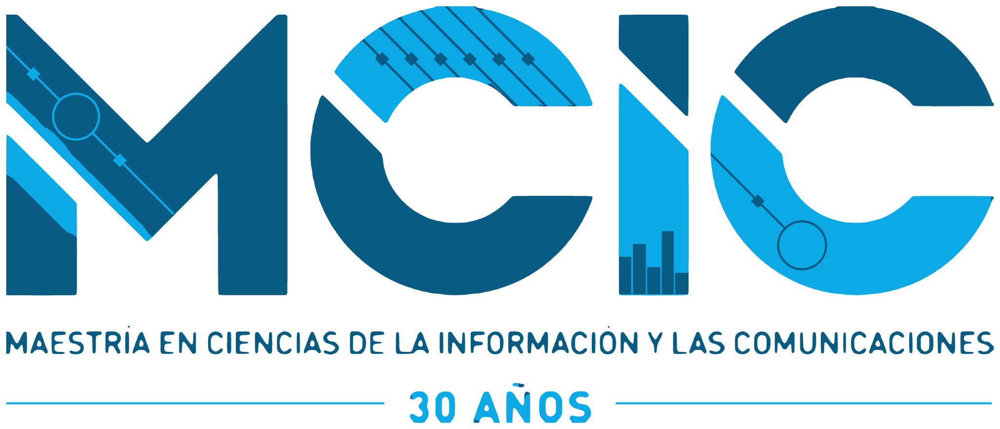
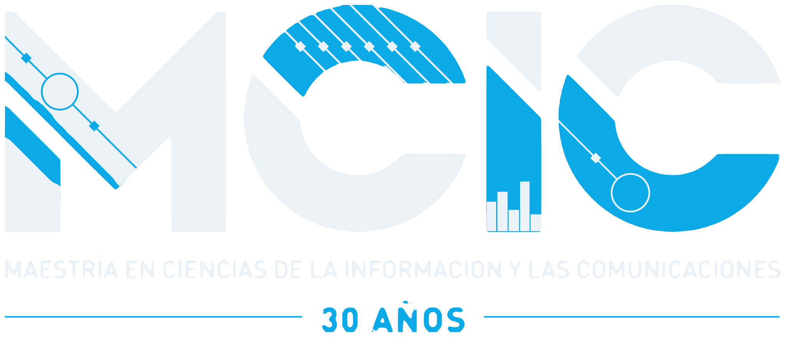
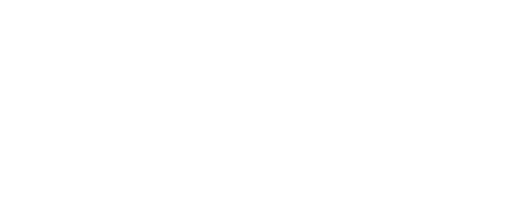
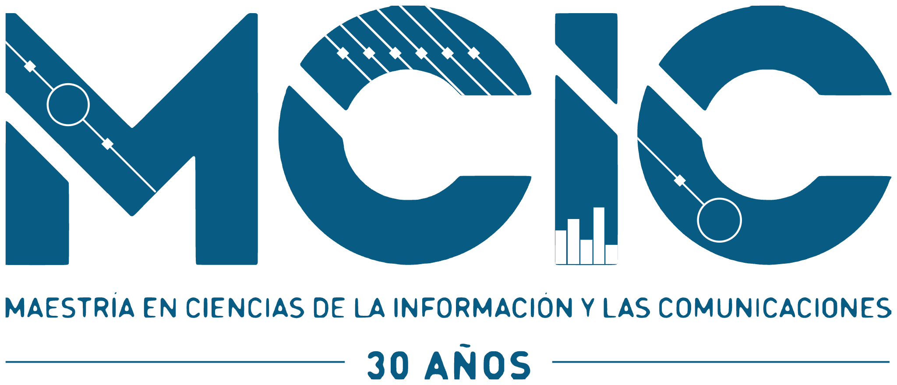

# Marca MCIC · kit vectorial

Logo de la Maestría en Ciencias de la Información y las Comunicaciones en SVG,
reconstruido a partir del PNG oficial (474 × 200 px), y el símbolo de nodos del
portafolio.

<p align="center">
  
</p>

## Archivos

### Logo completo (`svg/mcic-logo-*.svg`)

| Variante | Uso | Vista |
|----------|-----|-------|
| `color` | Fondos claros (versión original) |  |
| `invertido` | Fondos oscuros: el marino pasa a blanco, el cian se conserva |  |
| `blanco` | Una tinta sobre fotos o fondos de color |  |
| `marino` | Una tinta: impresión, sellos, grabado |  |

### Wordmark (`svg/mcic-wordmark-*.svg`)

Solo las letras **MCIC**, sin el texto inferior. Pensado para tamaños pequeños
(navbar, encabezados, favicons anchos), donde la línea de texto no se lee. Tiene
las mismas cuatro variantes.

### Símbolo de nodos (`svg/mcic-simbolo-*.svg`)

La "M" formada por nodos conectados, inspirada en las pistas de circuito del logo.
No es un logo oficial: es la marca del portafolio (favicon y app icon).

| Archivo | Uso |
|---------|-----|
| `mcic-simbolo-icono.svg` | Ícono de app con fondo (favicon, avatar) |
| `mcic-simbolo-color.svg` | Fondos claros, sin fondo propio |
| `mcic-simbolo-invertido.svg` | Fondos oscuros, sin fondo propio |
| `mcic-simbolo-mono.svg` | Una tinta con `currentColor`: insertado en línea, hereda el color del texto. Como `` se ve negro |

### PNG (`png/`)

Exportados con fondo transparente desde los SVG: logos a 2048 px de ancho,
wordmarks a 1600 px y símbolos a 1024 px.

### PDF vectorial (`pdf/`)

Para LaTeX, que no lee SVG directamente: `\includegraphics{mcic-logo-color.pdf}`.
Son 100 % vectoriales (sin imágenes incrustadas). Las plantillas del repositorio ya
los usan:

- `.UniversidadDistrital-manual-marca/plantillas-latex/assets/LogoMCIC.pdf` (portada del informe)
- `general/templates/Plantilla_Tareas_MCIC/LogoMCIC.pdf` (encabezado de tareas)

Todos los archivos incluyen un margen de 3 unidades alrededor del arte, porque el
PNG original toca los bordes del lienzo.

## Colores

| Tinta | Hex |
|-------|-----|
| Marino | `#085C84` |
| Cian | `#0BA9E6` |

Son los colores medidos en el PNG oficial. Para piezas institucionales de la
Universidad usa la paleta del manual de marca UD
(`.UniversidadDistrital-manual-marca/design.md`).

## Cómo se reconstruyó

`herramientas/vectorizar_logo.py` genera los ocho SVG del logo y del wordmark:

1. **Formas grandes**: por cada píxel calcula la cobertura real de tinta (los
   bordes del PNG vienen opacos y mezclados con blanco, así que usa el canal rojo)
   y el tono entre marino y cian. Luego escala ×8 con suavizado sub-píxel y vectoriza
   con potrace en dos capas apiladas: la silueta en cian abajo y el marino encima,
   para que no queden rendijas.
2. **Detalles finos**: las pistas de circuito, los nodos en diamante, los anillos,
   las barras de la I y los filetes miden 1 px en el original y no sobreviven a un
   trazado automático. Se redibujan como geometría pura con coordenadas medidas a
   mano y se recortan con la silueta (`clipPath`).

```bash
pip install pillow numpy potracer playwright
python herramientas/vectorizar_logo.py ../../docs/assets/mcic-logo.png svg/
python herramientas/exportar_png.py svg/ png/                          # PNG transparentes
python herramientas/svg_a_pdf.py svg/mcic-logo-color.svg pdf/mcic-logo-color.pdf
```

Los dos últimos usan Chrome headless (Playwright con `channel="chrome"`). Después de
regenerar, copia `pdf/mcic-logo-color.pdf` como `LogoMCIC.pdf` en las plantillas
LaTeX y `svg/mcic-wordmark-*.svg` en `docs/assets/` para el sitio.

> El original es un raster pequeño, así que esta es una reconstrucción fiel pero no
> el arte final del programa. Si la Maestría publica el vector oficial, ese tiene
> prioridad.
